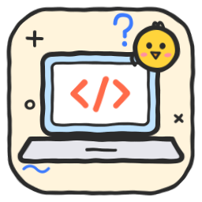
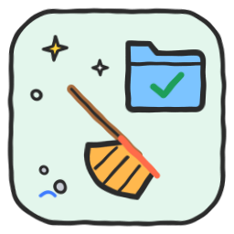

# Claude Skills — mozuraa's library

[](LICENSE)


**🇬🇧 English · [🇵🇹 Português](README.pt.md)**

---

All the [skills](#what-is-a-skill) for **Claude** I've created, organized by category. Every skill is included here in full, and each also has its own public repository with instructions, examples and an MIT license.

### Categories

| | Category | Skills |
|---|---|---|
| 🏗️ | **[Studios](estudios/)** (`estudios`): ideate, create and diagnose | `website-studio` · `app-studio` |
| 💡 | **[Ideas](ideias/)** (`ideias`) | `ideias-funcionalidades` · `ideias-monetizacao` · `brainstorming` |
| 🧑‍💻 | **[Programming](programacao/)** (`programacao`) | `code-for-noobs` |
| 🤖 | **[AI](ia/)** (`ia`): prompts | `prompt-studio` |
| 📣 | **[Launch](lancamento/)** (`lancamento`): video, kit and what's new | `creator-studio` |
| 🧹 | **[Maintenance](manutencao/)** (`manutencao`): GitHub and computer | `clean-studio` |

### Which skill do I need?

| I want... | Skill | Mode |
|---|---|---|
| ideas for a new **website**, or to improve mine | [`website-studio`](estudios/skills/website-studio/SKILL.md) | 💡 Ideate |
| to **build a website** from scratch | [`website-studio`](estudios/skills/website-studio/SKILL.md) | 🛠️ Create |
| to find and fix what's wrong with my **website** | [`website-studio`](estudios/skills/website-studio/SKILL.md) | 🩺 Diagnose |
| an idea for a new **app or game** | [`app-studio`](estudios/skills/app-studio/SKILL.md) | 💡 Ideate |
| to **build an app** and publish it on the App Store / Google Play | [`app-studio`](estudios/skills/app-studio/SKILL.md) | 🛠️ Create |
| to find what's wrong with my **app** and know if it's store-ready | [`app-studio`](estudios/skills/app-studio/SKILL.md) | 🩺 Diagnose |
| new features for an app I **already have** | [`ideias-funcionalidades`](ideias/skills/ideias-funcionalidades/SKILL.md) | |
| to make money from my app | [`ideias-monetizacao`](ideias/skills/ideias-monetizacao/SKILL.md) | |
| ideas about **anything else** | [`brainstorming`](ideias/skills/brainstorming/SKILL.md) | |
| to understand code, an error or a technical term | [`code-for-noobs`](programacao/skills/code-for-noobs/SKILL.md) | |
| a new **prompt** for ChatGPT, Claude, a GPT, an agent or Midjourney | [`prompt-studio`](ia/skills/prompt-studio/SKILL.md) | 🛠️ Create |
| to improve a **prompt**, find out why it fails, or move it to another model | [`prompt-studio`](ia/skills/prompt-studio/SKILL.md) | ✏️ Edit |
| a **launch video** of something I built (site, app, game) | [`creator-studio`](lancamento/skills/creator-studio/SKILL.md) | 🎬 Video |
| to **announce** my project: posts, Product Hunt, Show HN, OG image, GIF | [`creator-studio`](lancamento/skills/creator-studio/SKILL.md) | 📣 Kit |
| to show what's **new** in a release | [`creator-studio`](lancamento/skills/creator-studio/SKILL.md) | 🔄 What's new |
| to **tidy my GitHub repos** (stale repos, descriptions, branches, leaked secrets) | [`clean-studio`](manutencao/skills/clean-studio/SKILL.md) | 🐙 GitHub |
| to **free up space** or tidy folders on my Mac/PC | [`clean-studio`](manutencao/skills/clean-studio/SKILL.md) | 💻 Computer |

You don't have to choose: once the skills are installed, Claude picks the right one (and the right mode) whenever a request fits.

### Catalog

#### 🏗️ Studios

Each studio has three linked modes: **💡 Ideate → 🛠️ Create → 🩺 Diagnose**. They ask questions, show evidence, give honest opinions and only go ahead with your approval.

| | Skill | What it does | Version |
|---|---|---|---|
|  | [**website-studio**](https://github.com/mozuraa/claude-skill-website-studio) | **Websites, end to end.**<br>💡 Ideas for a new site, or for getting more contacts, sales and visits.<br>🛠️ Builds the site with you in 7 phases with 3 approval points (guides and a ready-made starter site).<br>🩺 Examines and fixes 12 areas (150+ checks): layout, images, speed, security, GDPR, accessibility, SEO. | 2.0.0 |
|  | [**app-studio**](https://github.com/mozuraa/claude-skill-app-studio) | **Apps (iOS, Android, Flutter, React Native), end to end.**<br>💡 Ideas for new apps and games.<br>🛠️ Builds the app with you, from MVP to the App Store and Google Play.<br>🩺 Examines and fixes 12 areas (140+ checks): crashes, layout, privacy, accessibility, purchases and store rules. | 2.0.0 |

#### 💡 Ideas

| | Skill | What it does | Version |
|---|---|---|---|
| | [**ideias-funcionalidades**](https://github.com/mozuraa/claude-skill-ideias-funcionalidades) | Ideas for **new features in an app or game that already exists**, checked against the code and with the files where they'd fit. | 1.0.1 |
| | [**ideias-monetizacao**](https://github.com/mozuraa/claude-skill-ideias-monetizacao) | Fair **monetization** strategies, with concrete prices, the right timing and store rules. | 1.0.1 |
| | [**brainstorming**](https://github.com/mozuraa/claude-skill-brainstorming) | **Brainstorming on any topic** (gifts, names, events, businesses), with the 2–3 best ideas ready to act on. | 1.0.1 |

#### 🧑‍💻 Programming

| | Skill | What it does | Version |
|---|---|---|---|
|  | [**code-for-noobs**](https://github.com/mozuraa/claude-skill-code-for-noobs) | Explains **code, errors and programming to people who have never coded**, in plain language, with analogies and a glossary of 40+ terms. | 1.0.0 |

#### 🤖 AI

| | Skill | What it does | Version |
|---|---|---|---|
|  | [**prompt-studio**](https://github.com/mozuraa/claude-skill-prompt-studio) | **Prompts for any AI** (Claude, ChatGPT, Gemini, agents, GPTs, API, image, video, music). It first works out the goal, the logic and the reasoning, then writes the best possible prompt.<br>🛠️ Creates new prompts, even from a vague idea.<br>✏️ Edits: diagnoses why a prompt fails, rewrites, shortens, translates or adapts it to another model, with a before/after score. | 1.0.0 |

#### 📣 Launch

| | Skill | What it does | Version |
|---|---|---|---|
|  | [**creator-studio**](https://github.com/mozuraa/claude-skill-creator-studio) | **You built it? Show it.** Inspired by [/brag](https://github.com/latent-spaces/brag), with everything it does and more.<br>🎬 A 15–30 s launch video in 9:16, 1:1 and 16:9, with real captures, 11 tones, original or licensed music, captions and optional voice-over.<br>📣 Kit: posts for X, LinkedIn, Instagram, TikTok, Product Hunt, Show HN and Reddit; OG image, GIF, App Store preview, checklist and schedule.<br>🔄 What's new: a video and posts about what changed in a release. | 1.1.0 |

#### 🧹 Maintenance

| | Skill | What it does | Version |
|---|---|---|---|
|  | [**clean-studio**](https://github.com/mozuraa/claude-skill-clean-studio) | **Tidy up without losing anything.** It analyses, shows a report and a plan, and only acts after you confirm (reversible actions first).<br>🐙 GitHub: inventory, archiving stale repos, descriptions and topics, merged branches, unchanged forks, leaked-secret alerts.<br>💻 Computer (Mac and Windows): what's taking up space, caches and `node_modules`, clones already on GitHub, duplicates, Downloads and folder structure. | 1.0.0 |

Skills derived from other people's content (for example, from Instagram posts) are kept in a separate private repository and are not part of this public library.

The list is also available as data in [`skills.json`](skills.json).

### Install

**1. Claude Code, as a plugin (recommended).** In Claude Code, type:

```
/plugin marketplace add mozuraa/claude-skills
```

Then install the categories you want:

```
/plugin install estudios@mozuraa-skills
/plugin install ideias@mozuraa-skills
/plugin install programacao@mozuraa-skills
/plugin install ia@mozuraa-skills
/plugin install lancamento@mozuraa-skills
/plugin install manutencao@mozuraa-skills
```

Get updates with `/plugin marketplace update mozuraa-skills`. Installed this way, skills are prefixed with their category (e.g. `/estudios:website-studio`).

**2. Claude Code, standalone skills.** One skill (replace `NAME`):

```bash
git clone https://github.com/mozuraa/claude-skill-NAME.git ~/.claude/skills/NAME
```

Or just tell Claude in a new chat: *"install the skill from this link: https://github.com/mozuraa/claude-skill-NAME"*.

All at once:

```bash
for s in website-studio app-studio ideias-funcionalidades ideias-monetizacao brainstorming code-for-noobs prompt-studio creator-studio clean-studio; do git clone https://github.com/mozuraa/claude-skill-$s.git ~/.claude/skills/$s; done
```

Update them all:

```bash
for s in website-studio app-studio ideias-funcionalidades ideias-monetizacao brainstorming code-for-noobs prompt-studio creator-studio clean-studio; do git -C ~/.claude/skills/$s pull; done
```

**3. Claude app / claude.ai.** Open the skill's repository, click **Code → Download ZIP**, then upload the ZIP under **Settings → Capabilities → Skills**.

Start a new session after installing.

### How it's organized

```
claude-skills/
├── .claude-plugin/marketplace.json   # plugin catalog for Claude Code
├── estudios/                         # 🏗️ "estudios" plugin
│   ├── .claude-plugin/plugin.json
│   └── skills/
│       ├── website-studio/           # SKILL.md · references/{idear,criar,diagnostico} · assets/starter
│       └── app-studio/               # SKILL.md · references/{idear,criar,diagnostico}
├── ideias/                           # 💡 "ideias" plugin
│   └── skills/
│       ├── ideias-funcionalidades/
│       ├── ideias-monetizacao/
│       └── brainstorming/
├── programacao/                      # 🧑‍💻 "programacao" plugin
│   └── skills/code-for-noobs/
├── ia/                               # 🤖 "ia" plugin
│   └── skills/prompt-studio/         # SKILL.md · references/ · assets/modelos
├── lancamento/                       # 📣 "lancamento" plugin
│   └── skills/creator-studio/         # SKILL.md · references/{video,kit,novidades} · assets/
├── manutencao/                       # 🧹 "manutencao" plugin
│   └── skills/clean-studio/          # SKILL.md · references/ (github, mac, windows...)
├── skills.json                       # the list as data
└── scripts/sincronizar.sh            # copies the skills here from their own repositories
```

The individual repositories are the source of truth; this library keeps organized copies, updated with `scripts/sincronizar.sh`.

### History

- **website-studio** merges the former *website-builder* and *website-doctor*.
- **app-studio** merges the former *ideias-apps* and *app-doctor*.
- Old *website-doctor* and *app-doctor* links redirect to the studios.

### What is a skill?

A skill is a folder with a `SKILL.md` file: a name, a description of when it should be used, and instructions. Claude only reads the description until it becomes relevant; when a request fits, it loads the instructions and follows them. It installs no programs: it's just text with instructions.

### Principles

- **Quality over quantity:** few, well-thought-out answers backed by evidence.
- **Fixed format:** the same sections every time, easy to compare.
- **Honest opinions:** the skills say what they'd do and why, but you decide.
- **Safe:** diagnoses only examine your own projects and never attack anything; clean-ups never act without your confirmation.
- **Any language:** the skills' instructions are written in Portuguese, but Claude replies in whatever language you write in.
- **Free:** MIT license.

### Feedback

Found a problem or have an idea for a skill? Open an issue in the skill's repository, or [here](https://github.com/mozuraa/claude-skills/issues) for new skill ideas.

---

## License

[MIT](LICENSE)
