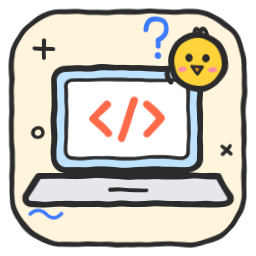

# Claude Skills — biblioteca de mozuraa

[](LICENSE)


**[Português](#português) · [English](#english)**

---

## Português

Todas as [skills](#o-que-é-uma-skill) para o **Claude** que criei, organizadas por categoria. Cada skill está completa aqui dentro e também tem o seu próprio repositório público, com instruções, exemplos e licença MIT.

### Categorias

| | Categoria | Skills |
|---|---|---|
| 🏗️ | **[Estúdios](estudios/)**: idear, criar e diagnosticar | `website-studio` · `app-studio` |
| 💡 | **[Ideias](ideias/)** | `ideias-funcionalidades` · `ideias-monetizacao` · `brainstorming` |
| 🧑‍💻 | **[Programação](programacao/)** | `code-for-noobs` |

### Que skill uso?

| Quero... | Skill | Modo |
|---|---|---|
| ideias para um **site** novo ou para melhorar o meu | [`website-studio`](estudios/skills/website-studio/SKILL.md) | 💡 Idear |
| **criar um site** de raiz | [`website-studio`](estudios/skills/website-studio/SKILL.md) | 🛠️ Criar |
| saber o que está mal no meu **site** e corrigir | [`website-studio`](estudios/skills/website-studio/SKILL.md) | 🩺 Diagnosticar |
| uma ideia para uma **app ou jogo novo** | [`app-studio`](estudios/skills/app-studio/SKILL.md) | 💡 Idear |
| **criar uma app** e publicá-la na App Store / Google Play | [`app-studio`](estudios/skills/app-studio/SKILL.md) | 🛠️ Criar |
| saber o que está mal na minha **app** e se está pronta para a loja | [`app-studio`](estudios/skills/app-studio/SKILL.md) | 🩺 Diagnosticar |
| funcionalidades novas para uma app que **já tenho** | [`ideias-funcionalidades`](ideias/skills/ideias-funcionalidades/SKILL.md) | |
| ganhar dinheiro com a minha app | [`ideias-monetizacao`](ideias/skills/ideias-monetizacao/SKILL.md) | |
| ideias sobre **outra coisa qualquer** | [`brainstorming`](ideias/skills/brainstorming/SKILL.md) | |
| perceber código, um erro ou um termo técnico | [`code-for-noobs`](programacao/skills/code-for-noobs/SKILL.md) | |

Não precisas de escolher: com as skills instaladas, o Claude usa a certa (e o modo certo) sozinho quando o pedido encaixa.

### Catálogo

#### 🏗️ Estúdios

Cada estúdio tem três modos que se encadeiam: **💡 Idear → 🛠️ Criar → 🩺 Diagnosticar**. Fazem perguntas, mostram provas, dão opinião honesta e só avançam com a tua autorização.

| | Skill | O que faz | Versão |
|---|---|---|---|
|  | [**website-studio**](https://github.com/mozuraa/claude-skill-website-studio) | **Websites, do início ao fim.**<br>💡 Ideias para um site novo ou para ter mais contactos, vendas e visitas.<br>🛠️ Cria o site contigo em 7 fases com 3 aprovações (guias e site-base pronto).<br>🩺 Examina e corrige 12 áreas (150+ verificações): layout, imagens, velocidade, segurança, RGPD, acessibilidade, SEO. | 2.0.0 |
|  | [**app-studio**](https://github.com/mozuraa/claude-skill-app-studio) | **Apps (iOS, Android, Flutter, React Native), do início ao fim.**<br>💡 Ideias de apps e jogos novos.<br>🛠️ Cria a app contigo, do MVP à App Store e ao Google Play.<br>🩺 Examina e corrige 12 áreas (140+ verificações): crashes, layout, privacidade, acessibilidade, compras e regras das lojas. | 2.0.0 |

#### 💡 Ideias

| | Skill | O que faz | Versão |
|---|---|---|---|
| | [**ideias-funcionalidades**](https://github.com/mozuraa/claude-skill-ideias-funcionalidades) | Ideias de **funcionalidades novas para uma app ou jogo que já existe**, verificadas contra o código e com os ficheiros onde encaixam. | 1.0.1 |
| | [**ideias-monetizacao**](https://github.com/mozuraa/claude-skill-ideias-monetizacao) | Estratégias de **monetização** justas, com preços concretos, momento certo e regras das lojas. | 1.0.1 |
| | [**brainstorming**](https://github.com/mozuraa/claude-skill-brainstorming) | **Brainstorming sobre qualquer tema** — presentes, nomes, eventos, negócios — com as 2–3 melhores ideias, prontas a pôr em prática. | 1.0.1 |

#### 🧑‍💻 Programação

| | Skill | O que faz | Versão |
|---|---|---|---|
|  | [**code-for-noobs**](https://github.com/mozuraa/claude-skill-code-for-noobs) | Explica **código, erros e programação a quem nunca programou**, em linguagem simples, com analogias e um glossário de 40+ termos. | 1.0.0 |

A lista também existe em formato de dados em [`skills.json`](skills.json).

### Instalar

**1. Claude Code — como plugin (recomendado).** No Claude Code, escreve:

```
/plugin marketplace add mozuraa/claude-skills
```

E depois instala as categorias que quiseres:

```
/plugin install estudios@mozuraa-skills
/plugin install ideias@mozuraa-skills
/plugin install programacao@mozuraa-skills
```

As atualizações chegam com `/plugin marketplace update mozuraa-skills`. Instaladas assim, as skills aparecem com o nome da categoria à frente (ex.: `/estudios:website-studio`).

**2. Claude Code — skills soltas.** Uma skill (troca `NOME`):

```bash
git clone https://github.com/mozuraa/claude-skill-NOME.git ~/.claude/skills/NOME
```

Todas de uma vez:

```bash
for s in website-studio app-studio ideias-funcionalidades ideias-monetizacao brainstorming code-for-noobs; do git clone https://github.com/mozuraa/claude-skill-$s.git ~/.claude/skills/$s; done
```

Atualizar todas:

```bash
for s in website-studio app-studio ideias-funcionalidades ideias-monetizacao brainstorming code-for-noobs; do git -C ~/.claude/skills/$s pull; done
```

**3. App Claude / claude.ai.** Abre o repositório da skill, carrega em **Code → Download ZIP** e carrega o ZIP nas **Definições**, na secção **Skills** (em *Capacidades*).

Abre uma sessão nova depois de instalar.

### Como está organizado

```
claude-skills/
├── .claude-plugin/marketplace.json   # catálogo de plugins para o Claude Code
├── estudios/                         # 🏗️ plugin "estudios"
│   ├── .claude-plugin/plugin.json
│   └── skills/
│       ├── website-studio/           # SKILL.md · references/{idear,criar,diagnostico} · assets/starter
│       └── app-studio/               # SKILL.md · references/{idear,criar,diagnostico}
├── ideias/                           # 💡 plugin "ideias"
│   └── skills/
│       ├── ideias-funcionalidades/
│       ├── ideias-monetizacao/
│       └── brainstorming/
├── programacao/                      # 🧑‍💻 plugin "programacao"
│   └── skills/code-for-noobs/
├── skills.json                       # a lista em formato de dados
└── scripts/sincronizar.sh            # copia as skills dos repositórios individuais para aqui
```

Os repositórios individuais são a fonte; esta biblioteca guarda cópias organizadas, atualizadas com `scripts/sincronizar.sh`.

### Histórico

- **website-studio** junta as antigas *website-builder* e *website-doctor*.
- **app-studio** junta as antigas *ideias-apps* e *app-doctor*.
- Os links antigos de *website-doctor* e *app-doctor* redirecionam para os estúdios.

### O que é uma skill?

Uma skill é uma pasta com um ficheiro `SKILL.md`: um nome, uma descrição de quando deve ser usada e instruções. O Claude lê só a descrição até ela ser útil; quando o pedido encaixa, carrega as instruções e segue-as. Não instala programas — é texto com instruções.

### Princípios destas skills

- **Qualidade acima de quantidade:** poucas respostas, bem pensadas e com provas.
- **Formato fixo:** as mesmas secções sempre, fáceis de comparar.
- **Opinião honesta:** as skills dizem o que fariam e porquê, mas tu decides.
- **Seguras:** os diagnósticos só examinam projetos teus e nunca atacam nada.
- **Qualquer língua:** as instruções estão em português, mas o Claude responde na língua em que lhe escreves.
- **Livres:** licença MIT.

### Sugestões

Encontraste um problema ou tens uma ideia para uma skill? Abre uma *issue* no repositório da skill, ou [aqui](https://github.com/mozuraa/claude-skills/issues) para ideias de skills novas.

---

## English

All the [skills](#what-is-a-skill) for **Claude** that I've created, organized by category. Every skill is included here in full and also has its own public repository with instructions, examples and an MIT license.

### Categories

| | Category | Skills |
|---|---|---|
| 🏗️ | **[Studios](estudios/)** (`estudios`): ideate, create and diagnose | `website-studio` · `app-studio` |
| 💡 | **[Ideas](ideias/)** (`ideias`) | `ideias-funcionalidades` · `ideias-monetizacao` · `brainstorming` |
| 🧑‍💻 | **[Programming](programacao/)** (`programacao`) | `code-for-noobs` |

### Which skill do I need?

| I want... | Skill | Mode |
|---|---|---|
| ideas for a new **website** or to improve mine | `website-studio` | 💡 Ideate |
| to **build a website** from scratch | `website-studio` | 🛠️ Create |
| to find and fix what's wrong with my **website** | `website-studio` | 🩺 Diagnose |
| an idea for a new **app or game** | `app-studio` | 💡 Ideate |
| to **build an app** and publish it on the App Store / Google Play | `app-studio` | 🛠️ Create |
| to find and fix what's wrong with my **app**, and know if it's store-ready | `app-studio` | 🩺 Diagnose |
| new features for an app I **already have** | `ideias-funcionalidades` | |
| to make money from my app | `ideias-monetizacao` | |
| ideas about **anything else** | `brainstorming` | |
| to understand code, an error or a technical term | `code-for-noobs` | |

You don't have to choose: once installed, Claude picks the right skill (and mode) on its own.

### Catalog

| Category | Skill | What it does |
|---|---|---|
| 🏗️ | [**website-studio**](https://github.com/mozuraa/claude-skill-website-studio) | **Websites end to end:** ideate, create from scratch with you (7 phases, guides, starter site), and diagnose & fix (12 areas, 150+ checks). |
| 🏗️ | [**app-studio**](https://github.com/mozuraa/claude-skill-app-studio) | **Apps end to end** (iOS, Android, Flutter, React Native): ideate, create from MVP to the App Store / Google Play, and diagnose & fix (12 areas, 140+ checks). |
| 💡 | [**ideias-funcionalidades**](https://github.com/mozuraa/claude-skill-ideias-funcionalidades) | **New feature ideas for an existing app or game**, checked against the code. |
| 💡 | [**ideias-monetizacao**](https://github.com/mozuraa/claude-skill-ideias-monetizacao) | Fair **monetization** strategies with concrete prices and store rules. |
| 💡 | [**brainstorming**](https://github.com/mozuraa/claude-skill-brainstorming) | **Brainstorming on any topic**, with the 2–3 best ready-to-act ideas. |
| 🧑‍💻 | [**code-for-noobs**](https://github.com/mozuraa/claude-skill-code-for-noobs) | Explains **code, errors and programming to people who have never coded**. |

### Install

**1. Claude Code, as a plugin (recommended):**

```
/plugin marketplace add mozuraa/claude-skills
/plugin install estudios@mozuraa-skills
/plugin install ideias@mozuraa-skills
/plugin install programacao@mozuraa-skills
```

Update with `/plugin marketplace update mozuraa-skills`. Installed this way, skills are prefixed with their category (e.g. `/estudios:website-studio`).

**2. Claude Code, standalone skills:**

```bash
for s in website-studio app-studio ideias-funcionalidades ideias-monetizacao brainstorming code-for-noobs; do git clone https://github.com/mozuraa/claude-skill-$s.git ~/.claude/skills/$s; done
```

**3. Claude app / claude.ai:** open the skill's repository, click **Code → Download ZIP** and upload it in **Settings**, under **Skills** (in *Capabilities*).

Start a new session after installing.

### History

**website-studio** merges the former *website-builder* and *website-doctor*; **app-studio** merges the former *ideias-apps* and *app-doctor*. Old *-doctor* links redirect to the studios.

### What is a skill?

A skill is a folder with a `SKILL.md` file: a name, a description of when it should be used, and instructions. Claude only reads the description until it becomes relevant; when a request matches, it loads the instructions and follows them.

### Principles

- **Quality over quantity:** few, well-thought-out answers backed by evidence.
- **Fixed format:** the same sections every time, easy to compare.
- **Honest opinions:** skills say what they'd do and why, but you decide.
- **Safe:** the diagnose modes only examine your own projects and never attack anything.
- **Any language:** instructions are in Portuguese, but Claude replies in the language you write in.
- **Free:** MIT license.

### Feedback

Found a problem or have an idea for a skill? Open an issue in the skill's repository, or [here](https://github.com/mozuraa/claude-skills/issues) for new skill ideas.

---

## License

[MIT](LICENSE)
