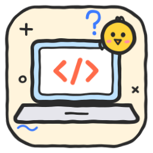
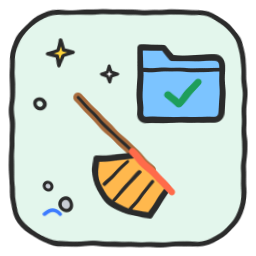

# Claude Skills — biblioteca de mozuraa

[](LICENSE)


**[🇬🇧 English](README.md) · 🇵🇹 Português**

---

Todas as [skills](#o-que-é-uma-skill) para o **Claude** que criei, organizadas por categoria. Cada skill está completa aqui dentro e também tem o seu próprio repositório público, com instruções, exemplos e licença MIT.

### Categorias

| | Categoria | Skills |
|---|---|---|
| 🏗️ | **[Estúdios](estudios/)**: idear, criar e diagnosticar | `website-studio` · `app-studio` |
| 💡 | **[Ideias](ideias/)** | `ideias-funcionalidades` · `ideias-monetizacao` · `brainstorming` |
| 🧑‍💻 | **[Programação](programacao/)** | `code-for-noobs` |
| 🤖 | **[IA](ia/)**: prompts | `prompt-studio` |
| 📣 | **[Lançamento](lancamento/)**: vídeo, kit e novidades | `creator-studio` |
| 🧹 | **[Manutenção](manutencao/)**: GitHub e computador | `clean-studio` |
| 🎨 | **[Design](design/)**: animação, vocabulário, fundos, estilos | `ui-motion-ux` · `design-vocabulary` · `depth-backgrounds` · `graphic-design-styles` |

### Que skill uso?

| Quero... | Skill | Modo |
|---|---|---|
| ideias para um **site** novo ou para melhorar o meu | [`website-studio`](estudios/skills/website-studio/SKILL.md) | 💡 Idear |
| **criar um site** de raiz | [`website-studio`](estudios/skills/website-studio/SKILL.md) | 🛠️ Criar |
| saber o que está mal no meu **site** e corrigir | [`website-studio`](estudios/skills/website-studio/SKILL.md) | 🩺 Diagnosticar |
| uma ideia para uma **app ou jogo novo** | [`app-studio`](estudios/skills/app-studio/SKILL.md) | 💡 Idear |
| **criar uma app** e publicá-la na App Store / Google Play | [`app-studio`](estudios/skills/app-studio/SKILL.md) | 🛠️ Criar |
| saber o que está mal na minha **app** e se está pronta para a loja | [`app-studio`](estudios/skills/app-studio/SKILL.md) | 🩺 Diagnosticar |
| funcionalidades novas para uma app que **já tenho** | [`ideias-funcionalidades`](ideias/skills/ideias-funcionalidades/SKILL.md) | |
| ganhar dinheiro com a minha app | [`ideias-monetizacao`](ideias/skills/ideias-monetizacao/SKILL.md) | |
| ideias sobre **outra coisa qualquer** | [`brainstorming`](ideias/skills/brainstorming/SKILL.md) | |
| perceber código, um erro ou um termo técnico | [`code-for-noobs`](programacao/skills/code-for-noobs/SKILL.md) | |
| uma **prompt** nova para o ChatGPT, o Claude, um GPT, um agente ou o Midjourney | [`prompt-studio`](ia/skills/prompt-studio/SKILL.md) | 🛠️ Criar |
| melhorar uma **prompt**, perceber porque falha ou passá-la para outro modelo | [`prompt-studio`](ia/skills/prompt-studio/SKILL.md) | ✏️ Editar |
| um **vídeo de lançamento** do que criei (site, app, jogo) | [`creator-studio`](lancamento/skills/creator-studio/SKILL.md) | 🎬 Vídeo |
| **anunciar** o meu projeto: posts, Product Hunt, Show HN, imagem OG, GIF | [`creator-studio`](lancamento/skills/creator-studio/SKILL.md) | 📣 Kit |
| mostrar o que há de **novo** numa versão | [`creator-studio`](lancamento/skills/creator-studio/SKILL.md) | 🔄 Novidades |
| **arrumar os meus repos** no GitHub (parados, descrições, branches, segredos expostos) | [`clean-studio`](manutencao/skills/clean-studio/SKILL.md) | 🐙 GitHub |
| **libertar espaço** ou arrumar pastas no Mac/PC | [`clean-studio`](manutencao/skills/clean-studio/SKILL.md) | 💻 Computador |
| melhores **animações** e UX na minha interface | [`ui-motion-ux`](design/skills/ui-motion-ux/SKILL.md) | |
| o **termo de design** certo para um problema (e a correção) | [`design-vocabulary`](design/skills/design-vocabulary/SKILL.md) | |
| um **fundo** com profundidade para um design | [`depth-backgrounds`](design/skills/depth-backgrounds/SKILL.md) | |
| um **estilo gráfico** (Y2K, suíço, cyberpunk...) com cores, fontes e prompts de imagem | [`graphic-design-styles`](design/skills/graphic-design-styles/SKILL.md) | |

Não precisas de escolher: com as skills instaladas, o Claude usa a certa (e o modo certo) sozinho quando o pedido encaixa.

### Catálogo

#### 🏗️ Estúdios

Cada estúdio tem três modos que se encadeiam: **💡 Idear → 🛠️ Criar → 🩺 Diagnosticar**. Fazem perguntas, mostram provas, dão opinião honesta e só avançam com a tua autorização.

| | Skill | O que faz | Versão |
|---|---|---|---|
|  | [**website-studio**](https://github.com/mozuraa/claude-skill-website-studio) | **Websites, do início ao fim.**<br>💡 Ideias para um site novo ou para ter mais contactos, vendas e visitas.<br>🛠️ Cria o site contigo em 7 fases com 3 aprovações (guias e site-base pronto).<br>🩺 Examina e corrige 12 áreas (150+ verificações): layout, imagens, velocidade, segurança, RGPD, acessibilidade, SEO. | 2.0.0 |
|  | [**app-studio**](https://github.com/mozuraa/claude-skill-app-studio) | **Apps (iOS, Android, Flutter, React Native), do início ao fim.**<br>💡 Ideias de apps e jogos novos.<br>🛠️ Cria a app contigo, do MVP à App Store e ao Google Play.<br>🩺 Examina e corrige 12 áreas (140+ verificações): crashes, layout, privacidade, acessibilidade, compras e regras das lojas. | 2.0.0 |

#### 💡 Ideias

| | Skill | O que faz | Versão |
|---|---|---|---|
| | [**ideias-funcionalidades**](https://github.com/mozuraa/claude-skill-ideias-funcionalidades) | Ideias de **funcionalidades novas para uma app ou jogo que já existe**, verificadas contra o código e com os ficheiros onde encaixam. | 1.0.1 |
| | [**ideias-monetizacao**](https://github.com/mozuraa/claude-skill-ideias-monetizacao) | Estratégias de **monetização** justas, com preços concretos, momento certo e regras das lojas. | 1.0.1 |
| | [**brainstorming**](https://github.com/mozuraa/claude-skill-brainstorming) | **Brainstorming sobre qualquer tema** — presentes, nomes, eventos, negócios — com as 2–3 melhores ideias, prontas a pôr em prática. | 1.0.1 |

#### 🧑‍💻 Programação

| | Skill | O que faz | Versão |
|---|---|---|---|
|  | [**code-for-noobs**](https://github.com/mozuraa/claude-skill-code-for-noobs) | Explica **código, erros e programação a quem nunca programou**, em linguagem simples, com analogias e um glossário de 40+ termos. | 1.0.0 |

#### 🤖 IA

| | Skill | O que faz | Versão |
|---|---|---|---|
|  | [**prompt-studio**](https://github.com/mozuraa/claude-skill-prompt-studio) | **Prompts para qualquer IA** (Claude, ChatGPT, Gemini, agentes, GPTs, API, imagem, vídeo, música). Primeiro percebe o objetivo, a lógica e o raciocínio; depois escreve a melhor prompt possível.<br>🛠️ Cria prompts novas, mesmo a partir de uma ideia vaga.<br>✏️ Edita: diagnostica porque falha, reescreve, encurta, traduz ou adapta a outro modelo, com nota antes/depois. | 1.0.0 |

#### 📣 Lançamento

| | Skill | O que faz | Versão |
|---|---|---|---|
|  | [**creator-studio**](https://github.com/mozuraa/claude-skill-creator-studio) | **Fizeste uma coisa? Mostra-a.** Inspirado no [/brag](https://github.com/latent-spaces/brag), com tudo o que ele faz e mais.<br>🎬 Vídeo de lançamento de 15–30 s em 9:16, 1:1 e 16:9, com capturas reais, 11 tons, música original ou licenciada, legendas e voz opcional.<br>📣 Kit: textos para X, LinkedIn, Instagram, TikTok, Product Hunt, Show HN e Reddit, imagem OG, GIF, pré-visualização da App Store, checklist e calendário.<br>🔄 Novidades: vídeo e posts do que mudou numa versão. | 1.1.0 |

#### 🧹 Manutenção

| | Skill | O que faz | Versão |
|---|---|---|---|
|  | [**clean-studio**](https://github.com/mozuraa/claude-skill-clean-studio) | **Arruma e limpa sem perder nada.** Analisa, mostra relatório e plano, e só age com a tua confirmação (reversível primeiro).<br>🐙 GitHub: inventário, arquivar parados, descrições e tópicos, branches fundidos, forks sem alterações, alerta de segredos expostos.<br>💻 Computador (Mac e Windows): o que ocupa espaço, caches e `node_modules`, clones já no GitHub, duplicados, Downloads e estrutura de pastas. | 1.0.0 |

#### 🎨 Design

Skills para interfaces mais bonitas e mais fáceis de usar. Cada uma indica a fonte e separa o que vem dela daquilo que foi acrescentado.

| | Skill | O que faz | Fonte |
|---|---|---|---|
| | [**ui-motion-ux**](design/skills/ui-motion-ux/SKILL.md) | Os 12 princípios de animação da Disney aplicados a UI + 8 leis de UX (Fitts, Hick, Doherty…), com durações, easings, tokens CSS e checklist de revisão. | [@charles.unemployed](https://www.instagram.com/reel/DfphRvFBx54/) |
| | [**design-vocabulary**](design/skills/design-vocabulary/SKILL.md) | 25 termos de design explicados com a correção de cada um (kerning, OKLCH, layout shift, safe area, empty state…). | [@charles.unemployed](https://www.instagram.com/reel/Dfh24cUh4KF/) |
| | [**depth-backgrounds**](design/skills/depth-backgrounds/SKILL.md) | 22 fundos para designs menos planos (grão, vidro canelado, blueprint, papel, ASCII…), com receitas CSS/SVG. | [@charles.unemployed](https://www.instagram.com/reel/DffEWqKhKWo/) |
| | [**graphic-design-styles**](design/skills/graphic-design-styles/SKILL.md) | 20 estilos gráficos (minimalismo, Y2K, suíço, cyberpunk…) com cores, fontes, usos e prompts de imagem. | [@gobirdmasterclass](https://www.instagram.com/reel/Dcl9lNHuG5c/) |

Estas skills vivem só nesta biblioteca (não têm repositório próprio).

A lista também existe em formato de dados em [`skills.json`](skills.json).

### Instalar

**1. Claude Code — como plugin (recomendado).** No Claude Code, escreve:

```
/plugin marketplace add mozuraa/claude-skills
```

E depois instala as categorias que quiseres:

```
/plugin install estudios@mozuraa-skills
/plugin install ideias@mozuraa-skills
/plugin install programacao@mozuraa-skills
/plugin install ia@mozuraa-skills
/plugin install lancamento@mozuraa-skills
/plugin install manutencao@mozuraa-skills
/plugin install design@mozuraa-skills
```

As atualizações chegam com `/plugin marketplace update mozuraa-skills`. Instaladas assim, as skills aparecem com o nome da categoria à frente (ex.: `/estudios:website-studio`).

**2. Claude Code — skills soltas.** Uma skill (troca `NOME`):

```bash
git clone https://github.com/mozuraa/claude-skill-NOME.git ~/.claude/skills/NOME
```

Todas de uma vez:

```bash
for s in website-studio app-studio ideias-funcionalidades ideias-monetizacao brainstorming code-for-noobs prompt-studio creator-studio clean-studio; do git clone https://github.com/mozuraa/claude-skill-$s.git ~/.claude/skills/$s; done
```

Atualizar todas:

```bash
for s in website-studio app-studio ideias-funcionalidades ideias-monetizacao brainstorming code-for-noobs prompt-studio creator-studio clean-studio; do git -C ~/.claude/skills/$s pull; done
```

**3. App Claude / claude.ai.** Abre o repositório da skill, carrega em **Code → Download ZIP** e carrega o ZIP nas **Definições**, na secção **Skills** (em *Capacidades*).

Abre uma sessão nova depois de instalar.

### Como está organizado

```
claude-skills/
├── .claude-plugin/marketplace.json   # catálogo de plugins para o Claude Code
├── estudios/                         # 🏗️ plugin "estudios"
│   ├── .claude-plugin/plugin.json
│   └── skills/
│       ├── website-studio/           # SKILL.md · references/{idear,criar,diagnostico} · assets/starter
│       └── app-studio/               # SKILL.md · references/{idear,criar,diagnostico}
├── ideias/                           # 💡 plugin "ideias"
│   └── skills/
│       ├── ideias-funcionalidades/
│       ├── ideias-monetizacao/
│       └── brainstorming/
├── programacao/                      # 🧑‍💻 plugin "programacao"
│   └── skills/code-for-noobs/
├── ia/                               # 🤖 plugin "ia"
│   └── skills/prompt-studio/         # SKILL.md · references/ · assets/modelos
├── lancamento/                       # 📣 plugin "lancamento"
│   └── skills/creator-studio/         # SKILL.md · references/{video,kit,novidades} · assets/
├── manutencao/                       # 🧹 plugin "manutencao"
│   └── skills/clean-studio/          # SKILL.md · references/ (github, mac, windows...)
├── design/                           # 🎨 plugin "design" (skills guardadas só aqui)
│   └── skills/{ui-motion-ux,design-vocabulary,depth-backgrounds,graphic-design-styles}/
├── skills.json                       # a lista em formato de dados
└── scripts/sincronizar.sh            # copia as skills dos repositórios individuais para aqui
```

Os repositórios individuais são a fonte; esta biblioteca guarda cópias organizadas, atualizadas com `scripts/sincronizar.sh`.

### Histórico

- **website-studio** junta as antigas *website-builder* e *website-doctor*.
- **app-studio** junta as antigas *ideias-apps* e *app-doctor*.
- Os links antigos de *website-doctor* e *app-doctor* redirecionam para os estúdios.

### O que é uma skill?

Uma skill é uma pasta com um ficheiro `SKILL.md`: um nome, uma descrição de quando deve ser usada e instruções. O Claude lê só a descrição até ela ser útil; quando o pedido encaixa, carrega as instruções e segue-as. Não instala programas — é texto com instruções.

### Princípios destas skills

- **Qualidade acima de quantidade:** poucas respostas, bem pensadas e com provas.
- **Formato fixo:** as mesmas secções sempre, fáceis de comparar.
- **Opinião honesta:** as skills dizem o que fariam e porquê, mas tu decides.
- **Seguras:** os diagnósticos só examinam projetos teus e nunca atacam nada.
- **Qualquer língua:** as instruções estão em português, mas o Claude responde na língua em que lhe escreves.
- **Livres:** licença MIT.

### Sugestões

Encontraste um problema ou tens uma ideia para uma skill? Abre uma *issue* no repositório da skill, ou [aqui](https://github.com/mozuraa/claude-skills/issues) para ideias de skills novas.

---

## Licença

[MIT](LICENSE)
