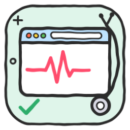
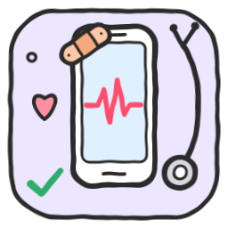

# 🩺 Diagnóstico

**Médicos** para os teus projetos: fazem perguntas, examinam tudo com provas, mostram um relatório de saúde por prioridades, dão a sua opinião sobre o que fazer primeiro e corrigem — só o que autorizares.
*Doctors for your projects: they ask questions, examine everything with evidence, show a prioritized health report, give their opinion on what to do first, and fix only what you approve.*

| | Skill | O que examina · What it examines | Repositório |
|---|---|---|---|
|  | [`website-doctor`](skills/website-doctor/SKILL.md) | **Websites** — 12 áreas, 150+ verificações: funcionamento, layout e alinhamentos, imagens, desempenho, segurança, privacidade/RGPD, acessibilidade, SEO, conteúdo, compatibilidade, domínio e email, código | [claude-skill-website-doctor](https://github.com/mozuraa/claude-skill-website-doctor) |
|  | [`app-doctor`](skills/app-doctor/SKILL.md) | **Apps** (iOS, Android, Flutter, React Native, desktop) — 12 áreas, 140+ verificações: crashes, layout, ícones, desempenho e bateria, segurança, privacidade, acessibilidade, regras da App Store e do Google Play, dados, compras, build | [claude-skill-app-doctor](https://github.com/mozuraa/claude-skill-app-doctor) |

### Como trabalham · How they work

🩺 Consulta → 🔬 Exame → 📋 Relatório de saúde → 💬 Opinião e perguntas → 🛠️ Tratamento → ✅ Alta

**Instalar esta categoria · Install this category** (Claude Code):

```
/plugin marketplace add mozuraa/claude-skills
/plugin install diagnostico@mozuraa-skills
```

[← Voltar à biblioteca · Back to the library](../README.md)
