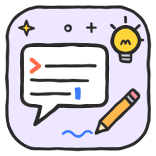

# 🤖 IA

Skills para **trabalhar melhor com inteligência artificial** — de qualquer marca.
*Skills to work better with AI, whatever the model.*

| | Skill | O que faz · What it does | Repositório |
|---|---|---|---|
|  | [`prompt-studio`](skills/prompt-studio/SKILL.md) | Cria e melhora prompts para qualquer IA. Primeiro percebe o **objetivo, a lógica e o raciocínio**, depois escreve a melhor prompt possível. 🛠️ Criar · ✏️ Editar · Creates and improves prompts for any AI, understanding the goal first | [claude-skill-prompt-studio](https://github.com/mozuraa/claude-skill-prompt-studio) |

**Instalar esta categoria · Install this category** (Claude Code):

```
/plugin marketplace add mozuraa/claude-skills
/plugin install ia@mozuraa-skills
```

[← Voltar à biblioteca · Back to the library](../README.md)
