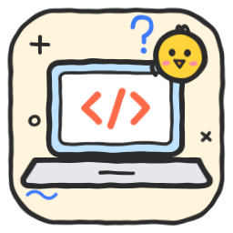

# 🧑‍💻 Programação

Skills para **perceber e aprender programação**, mesmo sem saber nada.
*Skills to understand and learn programming, even from zero.*

| | Skill | O que faz · What it does | Repositório |
|---|---|---|---|
|  | [`code-for-noobs`](skills/code-for-noobs/SKILL.md) | Explica código, erros e termos técnicos a principiantes, com analogias e um glossário de 40+ termos · Explains code, errors and jargon to beginners | [claude-skill-code-for-noobs](https://github.com/mozuraa/claude-skill-code-for-noobs) |

**Instalar esta categoria · Install this category** (Claude Code):

```
/plugin marketplace add mozuraa/claude-skills
/plugin install programacao@mozuraa-skills
```

[← Voltar à biblioteca · Back to the library](../README.md)
